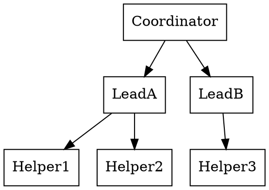
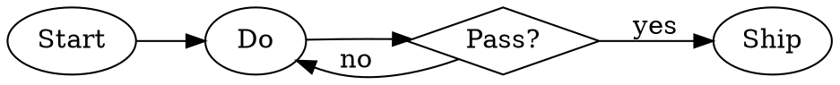
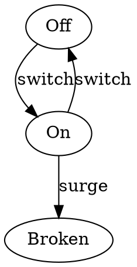

# Recipes

Small jobs, whole. Each recipe assumes a
working `dot` (chapter 3) and an invented
or honestly-known subject (chapter 1).

## An organisation chart

People and who they report to is `dot`'s
home ground: boxes, one rank per level,
edges pointing down from manager to team.



Add `rankdir=TB` (the default) and a
`label` with the chart's title and date.
A chart without a date is a claim about
forever; put the month on it.

## A process with a decision

Chapter 6's diamond earns its keep here:
the workshop pattern, shrunk to its bones.



Write the decision as a question with the
answers on its edges, and a reader can
walk the process without a narrator.

## A state machine

States are ellipses or circles; the
arrows are the events that move between
them, labelled with the event, never with
the destination (the arrow already says
the destination).



If an arrow needs two events, it is
usually two states wearing one name.

## A picture for a document

Render PDF for print, SVG for the web
version, from the same file, in the same
breath:

```bash
dot -Tpdf process.dot -o process.pdf
dot -Tsvg process.dot -o process.svg
```

Keep the `.dot` beside the document. The
next editor of the document is you, in
six months, and you will want the source.

## Clickable diagram for a web page

Give nodes a `URL` attribute and render
SVG:

```dot
Manual [URL="manual.html"];
```

Each linked node becomes a link in the
SVG. One diagram of the parts of a thing,
each part opening its own page: the
cheapest index a small project can have.

## Diff two versions of a system

Keep the DOT in version control beside
the system it describes. When the system
changes, the diagram change is a text
diff a reviewer can read in seconds —
*this arrow is new* — which is a review
no dragged-boxes picture has ever offered
anyone.

## From a list of pairs to a picture

Two columns of anything — *a, b* meaning
*a connects to b* — become a graph with
the chapter 11 pattern in any scripting
language, or ten lines of any text tool.
When the pairs live in a spreadsheet,
export CSV and start from
`graphviz-lab/pipeline/`, which is that
recipe already cooked.
