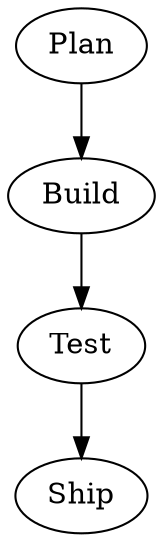

# What Graphviz Is

This chapter gives you the one idea the
whole guide hangs on: you describe a
diagram in words, and a program works
out where everything goes.

Most diagrams are drawn by hand. You drag
a box onto a page, drag an arrow to
another box, and nudge both until they
look right. Add one more box and the
nudging starts again. **Graphviz** takes
the opposite bargain. You write a short
text file that says what connects to
what — nothing about positions at all —
and Graphviz **lays out** the diagram:
it chooses the positions, routes the
arrows, and produces a picture.

The text language is called **DOT**. A
**graph** in DOT is a set of **nodes**
(the boxes, circles and other shapes)
joined by **edges** (the lines and
arrows between them). This is a complete,
working DOT file:

Four nodes, three arrows, no coordinates
anywhere. Feed it to Graphviz and you get
a tidy vertical diagram, Plan at the top,
Ship at the bottom. Change the text —
add a node, swap two arrows — and the
picture is redrawn from scratch, evenly
spaced, every time.

## Why anyone would do this

- **The picture stays honest.** The file
  says exactly which connections exist.
  Nothing is implied by two boxes merely
  sitting near each other, because the
  file never mentions sitting anywhere.
- **Diagrams can be remade.** A chart
  drawn by hand is finished when you stop
  dragging. A DOT file can be rendered
  again tomorrow, after an edit, by a
  script, on another machine, and come
  out the same.
- **Text is easy to keep.** DOT files sit
  happily in a folder, in an email, in
  version control next to the thing they
  describe. A difference between two
  versions is a difference you can read.
- **Machines can write them.** Anything
  that can print text can produce a DOT
  file. Chapter 11 generates a diagram
  from a small table of steps, which is
  where hand drawing stops being an
  option at all.

## The rule, stated before everything else

A diagram is a claim. It says *these
things connect, in this direction, in
this order* — and a reader believes it
because it looks finished and tidy. So
this guide has one rule:

> **Draw what you know, and label the
> rest as a guess.**

Graphviz will happily lay out a guess
with the same confidence as a fact. The
tidiness is the layout engine's; the
truth has to be yours. Every diagram in
this guide is invented — a fictional
club, a made-up workshop — precisely so
that no reader mistakes an example for a
claim about anything real.

## A familiar shape

Graphviz is not one program but a small
family (chapter 2). The program you will
use most is **dot**, which lays out
directed graphs — arrows with a sense of
*downhill* — in neat layers. Its siblings
(**neato**, **fdp**, **circo**, **twopi**
and others) lay the same text out by
different rules: as a network, in a
circle, around a centre. The file does
not change; the *engine* does, and
chapter 8 runs one small graph through
five engines so you can see the
difference with your own eyes.

Check: after installing (chapter 3), the
file above, saved as `first.dot` and
rendered with `dot -Tsvg`, produces an
SVG — a text file describing the picture —
whose opening lines name a viewBox of
about 296 by 227 points for this guide's
own first diagram (transcript
`graphviz-lab/transcripts/t01-first-diagram.txt`).
SVG being text is not a detail; it is how
this guide checks its own pictures, by
reading them back.

## Who it is for

Anyone who keeps redrawing the same
chart: a committee structure, the steps
of a process, the parts of a small
system, the family of ideas in a plan.
The common thread is a diagram whose
*connections* matter more than its exact
geometry — and a person who would rather
edit words than drag boxes.

## What it is not

Graphviz is not a drawing program: there
is no canvas, and you cannot place a node
*just there* — chapter 14 is honest about
how much control you give up. It is not a
charting tool for numbers: it draws no
bar charts or scatter plots. It does not
know what your diagram *means*; it knows
shapes and connections, and the meaning
stays your job. And it is not interactive:
the picture is an output, not a surface
you click on — though the SVG it makes
can carry links, as chapter 10 shows.
