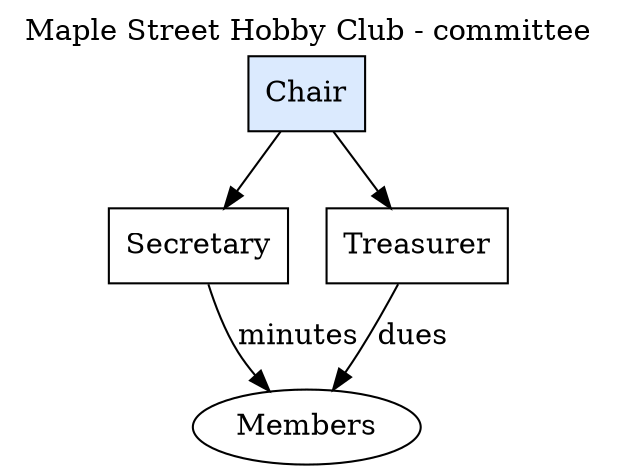

# Your First Diagram

This chapter ends with a finished,
labelled diagram of a small committee —
written by you, rendered by `dot`, and
checked by reading the picture back as
text.

The subject is invented: the **Maple
Street Hobby Club**, a fictional club with
a Chair, a Secretary, a Treasurer and its
Members. Four nodes and four arrows is
small enough to check by eye, and large
enough to show every move this chapter
makes. The lab's copy is
`graphviz-lab/first.dot`.

## The file



Read it top to bottom. Lines beginning
`//` are **comments** — notes to humans,
ignored by the engine. `digraph` opens a
directed graph and names it `Committee`;
the braces hold everything. The first two
lines inside are graph attributes: a
**title** for the whole picture, and
`labelloc="t"` placing that title at the
top. Then each node is given a shape —
boxes for the officers, an ellipse for
the Members — with the Chair also filled
with a pale blue. Last come the edges,
two of them labelled with what actually
flows along them: the Secretary sends
*minutes* to the Members; the Treasurer
sends *dues*.

Notice what is absent: positions, sizes,
distances. You said what exists and what
connects. The engine does the rest.

## The render

```bash
dot -Tsvg first.dot -o first.svg
```

One command, three parts: the engine
(`dot`), the format (`-Tsvg`), the input
file, and `-o` naming the output. Open
`first.svg` in a browser. The Chair sits
at the top, the officers in a row beneath,
the Members at the bottom, and the title
over all of it — a layout you did not
choose and did not need to.

Check: an SVG is text, so the picture can
be verified without eyes. The lab's render
(transcript `t01-first-diagram.txt`)
reports a **viewBox of 296 by 227 points**
and **9 `<title>` elements** — one for the
graph, one per node and edge. If your
numbers differ slightly, fonts are the
usual reason; if the file is empty or
missing, chapter 15 has the short list of
causes.

## Changing your mind

Editing is the point of the whole tool,
so do it once now. Add a fifth person —
say the club gains a Librarian who sends
*books* to the Members:

```dot
    Librarian [shape=box];
    Chair -> Librarian;
    Librarian -> Members [label="books"];
```

Render again. Nobody moved anything by
hand, yet the picture rebalanced itself:
three officers in the middle row, spacing
even, arrows rerouted. That small
experience — *edit words, get a new
diagram, lose nothing* — is the entire
bargain of chapter 1, delivered.

## The same file, other engines

Nothing in `first.dot` mentions `dot`.
Run it through `neato -Tsvg` and the
committee becomes a network, the Chair
near the middle, the Members pulled close
to both officers who feed them. Neither
picture is the true one; each engine
emphasises a different truth about the
same facts. Chapter 8 makes that its
whole subject.
